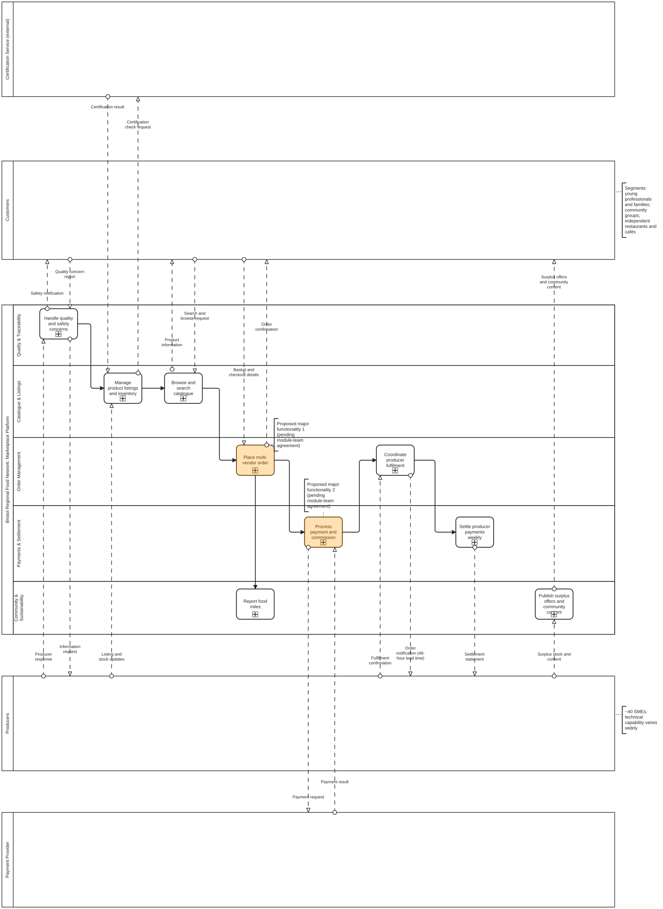

# DESD Group Project: Bristol Regional Food Network (Group 51)

UFCFTR-30-3 Distributed and Enterprise Software Development, 2026-27, Task 1.

## What this project is
An automated business process for the fictional Bristol Regional Food Network, a community marketplace linking about 40 local producers with customers within 20 miles of Bristol. We model it (i*, strategic BPMN, operational BPMN) and then make two processes executable in Camunda 8.

## Chosen use case
**Use Case 2: Customer Multi-Vendor Order, Checkout and Payment.**

Proposed major functionalities (pending module-team agreement):
1. **Basket to order:** availability check with amend loop, delivery or collection decision, customer confirmation, order creation and per-producer split.
2. **Payment and commission:** payment via a sandbox service with approved, declined-with-retry and unavailable paths; inventory update; producer notification; per-producer amounts and 5% commission.

## Group
| Student | ID | Role |
|---|---|---|
| Esila Keskin | 24064432 | Project lead, project coordination, modelling lead, repository administrator |
| Mahtab Bin Lokman | 24038250 | Functionality 1 lead (basket to order) |
| Dylan (Ella) Morgan | 24030018 | Functionality 2 lead (payment and commissions) |
| Bruno Pedro | 22074709 | Implementation, testing |

## Sprint 1 deliverables
- Strategic BPMN: [`models/strategic/strategic-bpmn-v1.bpmn`](models/strategic/strategic-bpmn-v1.bpmn) ([SVG](models/strategic/strategic-bpmn-v1.svg))
- Justification with case-study evidence: [`docs/strategic-bpmn-justification.md`](docs/strategic-bpmn-justification.md)
- Case study analysis: [`docs/case-study-analysis.md`](docs/case-study-analysis.md)
- Functionality selection: [`docs/functionality-selection.md`](docs/functionality-selection.md)
- Legal, ethical, social and professional considerations: [`docs/lesp-considerations.md`](docs/lesp-considerations.md)
- Sprint 1 plan: [`docs/sprint-1-plan.md`](docs/sprint-1-plan.md)
- Traceability matrix: [`docs/traceability-matrix.md`](docs/traceability-matrix.md)
- Decisions, assumptions, open questions and risks: [`docs/decisions-and-assumptions.md`](docs/decisions-and-assumptions.md)
- Open questions for Functionality 1: [`docs/f1-open-questions.md`](docs/f1-open-questions.md)
- Test plan outline: [`docs/test-plan-outline.md`](docs/test-plan-outline.md)
- Contributions log: [`CONTRIBUTIONS.md`](CONTRIBUTIONS.md)
- Project board: https://github.com/users/esila-keskin/projects/1 

## Opening the models
Import the `.bpmn` file into Camunda 8 Web Modeler, or view the SVG directly.

## Validation notes
The strategic BPMN is deliberately non-executable. Camunda's Implement-mode checks flag the pools as non-executable and the collapsed sub-processes as lacking start and end events. This is expected at the strategic level; the two selected functionalities become executable operational models in Sprint 2.

## Working agreement
Everyone commits under their own account. Work on a branch and open a pull request. Commit messages name the task. Every pull request is reviewed by someone other than its author.

## Use of generative AI
Each member declares their own use, and each can explain the work they present.
- Esila Keskin used an AI assistant (Claude) to discuss and analyse the case study, and to help draft the written documents in docs/. The strategic BPMN model was drawn by hand in Camunda Web Modeler. Its structure and every shape and documentation entry were checked and adjusted against the case study, and no diagram file was generated by AI. All text was reviewed before it was committed.
- Mahtab Bin Lokman: Mahtab Bin Lokman have used Claude AI (an AI chatbot) to help in understanding the tasks more accurately and to tidy the grammar and structure the issue comments and f1-open-questions.md. The questions, suggestions and choices are from own thought, and  haven’t used it to create any models or code
- Ella Morgan: (own statement)
- Bruno Pedro: (own statement)

